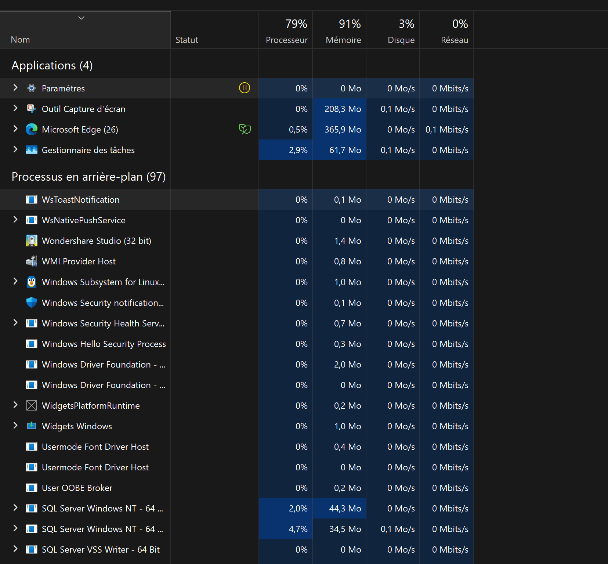
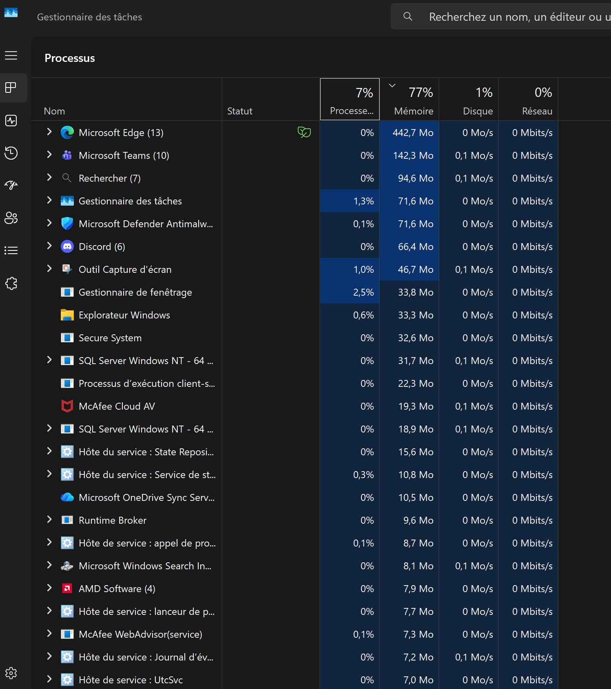
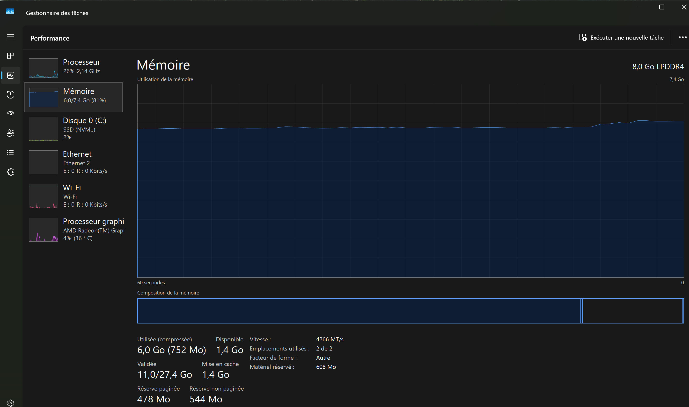
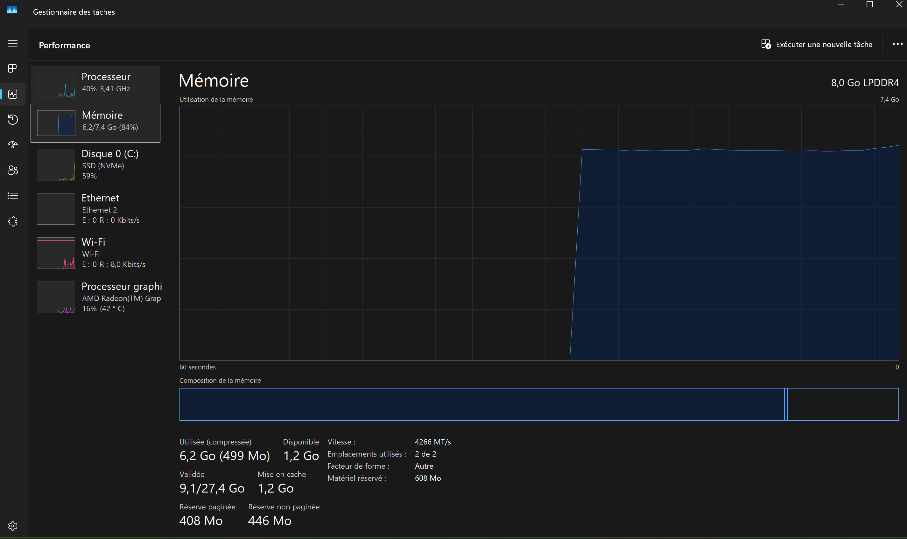
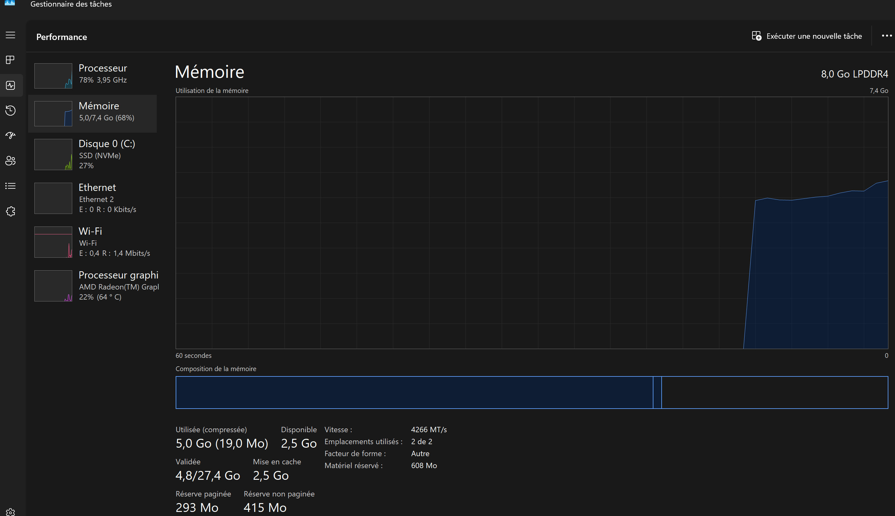

# Labo 1 : diagnostic d'un ordinateur lent (mémoire saturée)

## Objectif

Appliquer une méthode de dépannage structurée à un cas réel : mon propre portable, dont la mémoire (RAM) était presque pleine. Le but est d'identifier la cause, de tester des théories une à une et de mesurer l'effet de chaque action.

## Environnement

| Élément | Valeur |
|---|---|
| Système | Windows 11 Famille (version 26H2) |
| Processeur | AMD Ryzen 5 5600H |
| RAM | 8 Go LPDDR4 (7,4 Go utilisables, 608 Mo réservés au matériel) |
| Stockage | SSD NVMe |
| Outil de diagnostic | Gestionnaire des tâches (Ctrl + Maj + Échap) |

## Méthode utilisée

## Déroulement

### 1. Identifier le problème

Au repos, la mémoire utilisée dépassait 80 % de la RAM disponible. Sur la première capture, triée par nom, elle atteignait même 91 % avec un processeur à 79 %. Cette capture n'était pas utile, car la liste n'était pas triée par consommation.

**Leçon :** il faut trier la colonne **Mémoire** pour voir les plus gros consommateurs.

### 2. Observer les processus (triés par mémoire)

Les plus gros consommateurs visibles étaient Microsoft Edge (environ 443 Mo), Teams (142 Mo), Rechercher (95 Mo), Microsoft Defender (72 Mo) et Discord (66 Mo). SQL Server (environ 50 Mo au total) et McAfee apparaissaient aussi.

Les lignes visibles totalisaient environ 1,2 Go, alors que la mémoire utilisée était d'environ 6 Go. Il n'y avait donc pas un seul coupable : la consommation était répartie sur de nombreux processus.

### 3. Analyser la composition de la mémoire

Onglet **Performances > Mémoire**, avant toute action :

| Mesure | Valeur |
|---|---|
| Utilisée | 6,0 Go (81 %) |
| Compressée | 752 Mo |
| Disponible | 1,4 Go |
| Validée | 11,0 / 27,4 Go |
| Disque | 2 % |
| Processeur | 26 % |

Le disque et le processeur étaient peu sollicités : le problème venait bien de la mémoire. La quantité de mémoire compressée et la mémoire validée supérieure à la RAM physique montrent que Windows devait s'appuyer sur la compression et sur le fichier d'échange.

## Théories testées

### Théorie 1 : l'ordinateur n'a pas été redémarré depuis longtemps

**Action :** redémarrage complet (« Redémarrer », et non « Arrêter »).

**Résultat : théorie réfutée.** La mémoire utilisée est passée de 6,0 Go à 6,2 Go. Le graphique montre un saut à environ 6 Go dès le démarrage : la mémoire était déjà utilisée juste après l'allumage, avant toute ouverture de programme.

Le disque (59 %) et le processeur (40 %) étaient élevés, car la capture a été prise pendant le démarrage de Windows.

### Théorie 2 : des programmes se lancent automatiquement au démarrage

**Action :** désactivation du démarrage automatique de **Teams** et de **Discord**
(Gestionnaire des tâches > Applications de démarrage > clic droit > Désactiver), puis redémarrage.

**Résultat : théorie confirmée.**

| Mesure | Après redémarrage | Après désactivation |
|---|---|---|
| Mémoire utilisée | 6,2 Go (84 %) | **5,0 Go (68 %)** |
| Mémoire disponible | 1,2 Go | **2,5 Go** |
| Mémoire validée | 9,1 Go | **4,8 Go** |
| Mémoire compressée | 499 Mo | **19 Mo** |

Gain d'environ **1,2 Go** de mémoire utilisée, et la mémoire disponible a plus que doublé.

### Action complémentaire

J'ai aussi désinstallé SQL Server Management Studio (l'outil graphique), que je n'utilisais pas. Je n'ai pas mesuré son effet séparément. Cet outil n'utilise de la mémoire que lorsqu'il est ouvert, donc l'impact attendu est faible. Le moteur SQL Server, lui, est un service distinct, que je n'ai pas désinstallé.

## Ticket de résolution

> **Problème :** ordinateur lent, mémoire utilisée à plus de 80 % au repos.
> **Cause :** programmes lancés automatiquement au démarrage (notamment Teams et Discord), qui occupaient environ 1,2 Go de mémoire.
> **Actions :** redémarrage (sans effet), puis désactivation du démarrage automatique de Teams et Discord.
> **Résultat :** mémoire utilisée passée de 6,2 Go (84 %) à 5,0 Go (68 %).
> **Suivi possible :** examiner les autres applications de démarrage (antivirus, SQL Server).

## Limites de cette analyse

- Deux applications ont été désactivées en même temps : je ne sais pas laquelle a eu le plus d'effet.
- La dernière mesure a été prise peu après le démarrage (processeur à 78 %), avant que le système soit complètement stabilisé.
- Chaque mesure est ponctuelle ; une comparaison plus rigoureuse demanderait plusieurs relevés.
- Une machine virtuelle Windows demande environ 4 Go. Avec 2,5 Go disponibles au repos, ce n'est pas encore possible sans libérer davantage de mémoire.

## Ce que j'ai appris

- Lire l'onglet Performances : utilisée, disponible, compressée, validée, matériel réservé.
- Une théorie réfutée fait partie du diagnostic : le redémarrage n'a rien réglé, et c'est ce qui a orienté vers la bonne cause.
- Mesurer avant et après chaque action, et changer une chose à la fois pour savoir ce qui fonctionne.
- Une liste de processus donne des indices, mais seule la mesure confirme l'effet d'une action.
- Distinguer SQL Server (le service) de SQL Server Management Studio (l'outil graphique).
