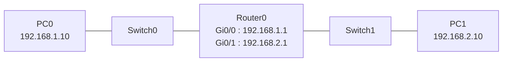
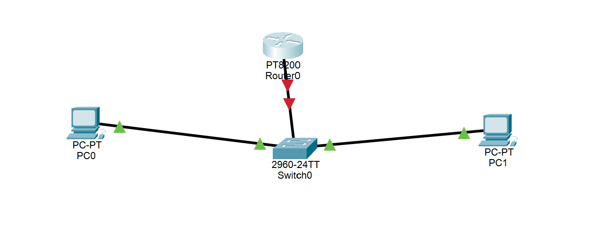
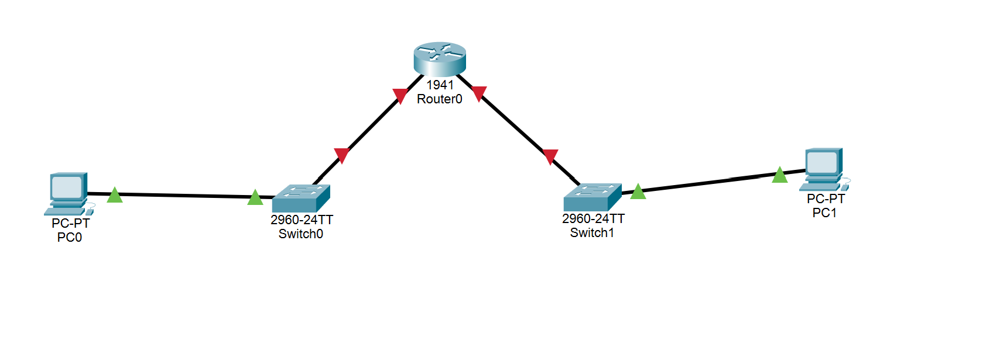
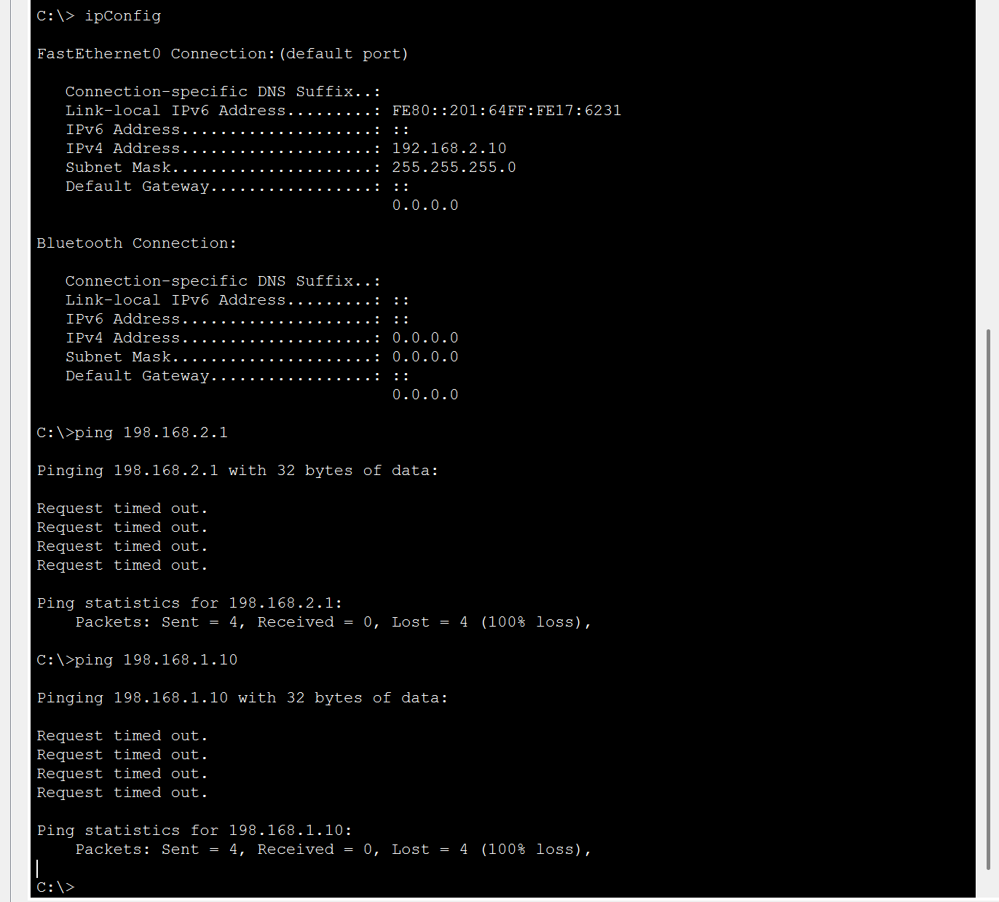
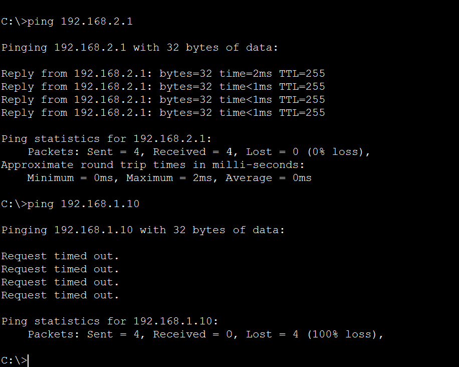

# Labo 2 : deux réseaux reliés par un routeur, et panne de passerelle

## Objectif

Vérifier la communication entre deux machines situées sur des réseaux différents, comprendre le rôle de la passerelle par défaut, puis provoquer et diagnostiquer une panne de passerelle comme le ferait un technicien de soutien de niveau 1.

## Environnement

| Élément | Valeur |
|---|---|
| Outil | Cisco Packet Tracer |
| Équipements | 2 PC, 2 switches 2960-24TT (Switch0, Switch1), 1 routeur Cisco 1941 (Router0) |
| Câbles | Cuivre droits (Copper Straight-Through) |

## Plan du réseau



| Appareil | Adresse IP | Masque | Passerelle |
|---|---|---|---|
| PC0 | 192.168.1.10 | 255.255.255.0 | 192.168.1.1 |
| PC1 | 192.168.2.10 | 255.255.255.0 | 192.168.2.1 |
| Router0 Gi0/0 | 192.168.1.1 | 255.255.255.0 | |
| Router0 Gi0/1 | 192.168.2.1 | 255.255.255.0 | |

Chaque côté du routeur forme un réseau distinct. Pour que PC0 et PC1 communiquent, leur trafic passe par le routeur, qui est la passerelle de chacun.

## Mise en place

### Première erreur : routeur branché sur le même switch

Mon premier montage reliait le routeur au même switch que les deux PC.



Dans ce montage, PC0, PC1 et le routeur sont tous sur un seul réseau : le routeur n'a rien à relier, et un `ping` entre les deux PC ne passerait jamais par lui. Les triangles rouges indiquaient que les interfaces du routeur étaient encore éteintes (elles le sont par défaut).

**Correction :** ajout d'un deuxième switch et d'une deuxième interface du routeur, pour obtenir deux réseaux séparés.



Les triangles rouges restants sont normaux à ce stade : les interfaces du routeur n'étaient pas encore activées.

### Configuration du routeur

J'ai configuré les deux interfaces du routeur avec leur adresse, puis activé chacune avec `no shutdown`. Vérification :

```
Router#show ip interface brief
Interface              IP-Address      OK? Method Status                Protocol
GigabitEthernet0/0     192.168.1.1     YES manual up                    up
GigabitEthernet0/1     192.168.2.1     YES manual up                    up
Vlan1                  unassigned      YES unset  administratively down down
```

Les deux interfaces sont `up / up` avec les bonnes adresses.

## Vérification de la communication (état normal)

Depuis PC1 :

```
C:\>ipconfig
   IPv4 Address....................: 192.168.2.10
   Subnet Mask.....................: 255.255.255.0
   Default Gateway.................: 192.168.2.1

C:\>ping 192.168.1.10
Request timed out.
Reply from 192.168.1.10: bytes=32 time=10ms TTL=127
Reply from 192.168.1.10: bytes=32 time<1ms TTL=127
Reply from 192.168.1.10: bytes=32 time<1ms TTL=127
Packets: Sent = 4, Received = 3, Lost = 1 (25% loss)

C:\>tracert 192.168.1.10
  1   0 ms      0 ms      0 ms      192.168.2.1
  2   0 ms      0 ms      0 ms      192.168.1.10
Trace complete.
```

**Ce que j'en conclus :**

- Le premier paquet est perdu parce que les machines doivent d'abord découvrir les adresses physiques les unes des autres (ARP). Les suivants passent.
- Le `tracert` montre deux sauts : le routeur (192.168.2.1), puis PC0. Le trafic traverse bien le routeur.
- Le TTL est de **127**, alors qu'il était de 128 dans un réseau à un seul switch : il baisse de 1 à chaque routeur traversé.

## Panne volontaire : suppression de la passerelle de PC1

**Action :** effacer la passerelle par défaut de PC1 (adresse et masque inchangés).

**Résultat de `ipconfig` pendant la panne :** `Default Gateway : 0.0.0.0`

### Tentative n° 1 : erreur de saisie

Mes premiers `ping` ont tous échoué.



En relisant ma capture, j'ai constaté que j'avais tapé **198**.168.2.1 et **198**.168.1.10 au lieu de **192**.168.x.x. Les deux `ping` ne pouvaient pas fonctionner, indépendamment de la passerelle.

**Leçon :** quand un `ping` échoue, vérifier d'abord l'adresse tapée avant de conclure à une panne.

### Tentative n° 2 : adresses corrigées



| Test | Résultat |
|---|---|
| `ping 192.168.2.1` (routeur, même réseau que PC1) | **Réussi**, TTL 255 |
| `ping 192.168.1.10` (PC0, autre réseau) | **Échoué**, 100 % de perte |

**Pourquoi :** un PC envoie directement les paquets destinés à son propre réseau. Pour joindre un autre réseau, il doit passer par sa passerelle. Sans passerelle, le routeur reste joignable (il a une interface dans le réseau de PC1), mais PC0 ne l'est plus.

## Ticket de résolution

> **Symptôme :** PC1 joint le routeur (192.168.2.1) mais pas PC0 (192.168.1.10).
> **Diagnostic :** `ipconfig` montre une passerelle par défaut vide. Le trafic local fonctionne, le trafic vers un autre réseau échoue.
> **Cause :** passerelle par défaut absente sur PC1.
> **Action :** renseigner 192.168.2.1 comme passerelle par défaut.
> **Vérification :** `ping 192.168.2.1` et `ping 192.168.1.10` réussissent (0 % de perte, TTL 127 vers PC0, ce qui confirme le passage par le routeur).

## Rétablissement et vérification

Après avoir remis la passerelle 192.168.2.1 sur PC1 :

```
C:\>ping 192.168.2.1
Packets: Sent = 4, Received = 4, Lost = 0 (0% loss)

C:\>ping 192.168.1.10
Packets: Sent = 4, Received = 4, Lost = 0 (0% loss)   (TTL=127)
```

La communication est rétablie.

## Problèmes rencontrés

| Problème | Cause | Solution |
|---|---|---|
| Routeur inutile dans le schéma | Branché sur le même switch que les deux PC | Ajout d'un deuxième switch et d'une deuxième interface |
| Commandes refusées au routeur (`% Invalid input`) | J'étais resté en mode utilisateur (`Router>`) : `enable` avait été pris comme réponse à la question de configuration initiale | Taper `enable` pour passer en mode privilégié (`Router#`), puis configurer |
| Tous les `ping` échouent pendant la panne | Faute de frappe : 198 au lieu de 192 | Relire l'adresse tapée, refaire les tests |

## Limites de cette analyse

- Une seule panne a été testée (passerelle absente), sur un seul PC.
- C'est une simulation : le comportement d'un vrai réseau (retards, pare-feu, autres équipements) peut différer.
- Je n'ai pas testé les autres causes possibles de ce type de symptôme (mauvaise passerelle, câble débranché, interface du routeur éteinte).

## Ce que j'ai appris

- La passerelle sert à **sortir de son réseau**. Sans elle, les voisins du même réseau restent joignables, mais plus rien d'autre.
- Le TTL baisse de 1 à chaque routeur traversé : c'est un indice qui prouve qu'un paquet est passé par un routeur (127 au lieu de 128).
- `tracert` montre le chemin saut par saut, et permet de situer où un paquet s'arrête.
- Perdre seulement le premier paquet est normal (ARP) ; en perdre tous indique un vrai problème.
- Les modes de la ligne de commande Cisco se reconnaissent au symbole de l'invite (`>`, `#`, `(config)#`).
- Avant de conclure à une panne, vérifier que mon propre test est correct (ici, l'adresse tapée).
